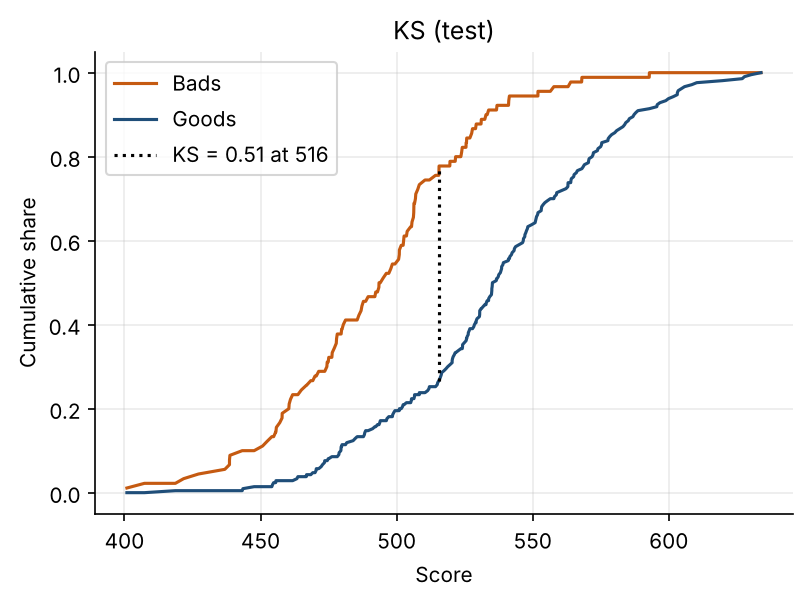

# Credit Risk Scorecard

[](https://github.com/LusandaNongogo/credit-risk-scorecard/actions/workflows/tests.yml)

An application PD scorecard built and validated end to end in Python, then extended with two things South African lenders deal with every day: an NCR style affordability check and IFRS 9 expected credit loss.

## Results

| Sample | AUC | Gini | KS |
| --- | ---: | ---: | ---: |
| Train (700) | 0.835 | 0.669 | 0.537 |
| Test (300) | 0.799 | 0.597 | 0.511 |

- 12 of 18 features kept after IV filtering, all coefficient signs as expected
- PSI between train and test scores: 0.062 (stable)
- Mean predicted PD 0.294 vs actual bad rate 0.300 on test
- Scaling: 600 points at 50:1 good:bad odds, 20 points to double the odds



## What It Does

1. Stratified 70/30 split with a fixed seed
2. WoE binning and IV for every feature; IV below 0.02 dropped, above 0.5 flagged
3. Logistic regression on the WoE features with a coefficient sign check
4. Scorecard points table
5. AUC, Gini and KS on train and test, with ROC, KS and score distribution charts
6. PSI between train and test scores
7. Predicted vs actual bad rate by score decile
8. Affordability check using the NCR minimum expense norms
9. Simplified IFRS 9 staging and ECL

The full write up, including limitations, is in [reports/validation.md](reports/validation.md).

## Fairness

Two columns are removed before any modelling:

- `personal_status_and_sex` combines marital status with sex
- `foreign_worker` is a proxy for nationality

Both are protected characteristics. A model that used them could treat people differently because of who they are rather than how they handle credit, which is unfair and, in South Africa, conflicts with the Constitution's equality clause and the Equality Act. Taking them out before binning means they cannot influence which features are selected. Age is still in the model, which is common in credit scoring but is also a protected ground, so the report notes it needs a documented justification.

## Data

The German Credit data (1 000 loans, 30% bad) loaded from `scorecardpy.germancredit()`, so there is nothing to download and no API keys. It is small, old and not South African, so treat the results as a demonstration of method. The report covers what would change on local bureau data.

## Project Structure

```
src/
  data.py           loading, exclusions, stratified split
  woe.py            WoE, IV, binning and feature selection
  model.py          logistic regression and sign check
  scorecard.py      points scaling and scorecard table
  metrics.py        AUC, Gini, KS, PSI, calibration
  plots.py          charts
  affordability.py  NCR style affordability check
  ecl.py            IFRS 9 staging and ECL
notebooks/
  scorecard.ipynb   the full walk through with outputs
reports/
  validation.md     validation report
  figures/          saved charts
tests/              pytest tests for WoE, metrics, scaling, affordability and ECL
```

## Setup (Windows)

```
git clone https://github.com/LusandaNongogo/credit-risk-scorecard.git
cd credit-risk-scorecard
py -m venv .venv
.venv\Scripts\activate
py -m pip install -r requirements.txt
```

Run the tests:

```
py -m pytest
```

Open the notebook:

```
py -m jupyter notebook notebooks/scorecard.ipynb
```

`scorecardpy` is an older package, so `requirements.txt` pins `pandas` below 3 and `setuptools` below 81. Without those pins the install or the binning step fails.
